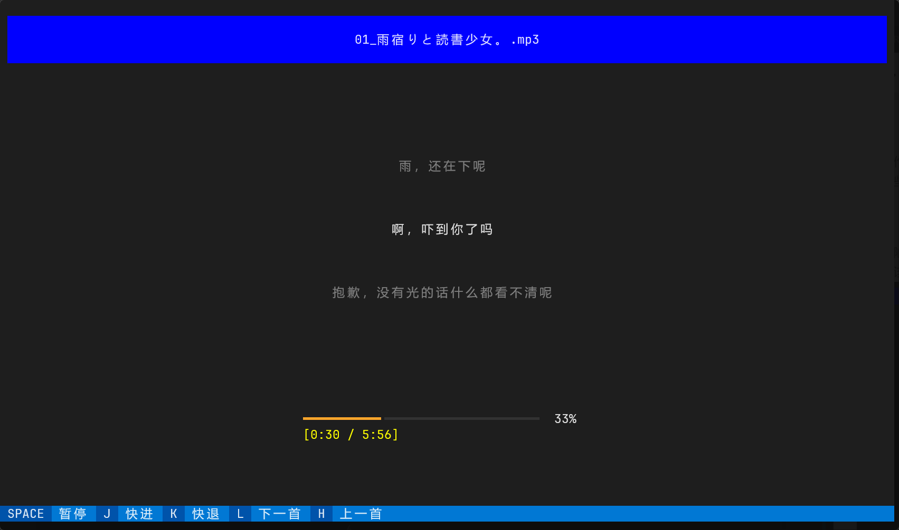
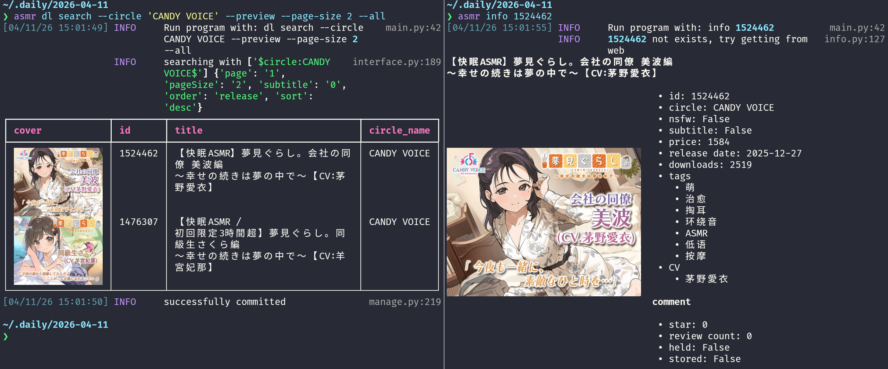
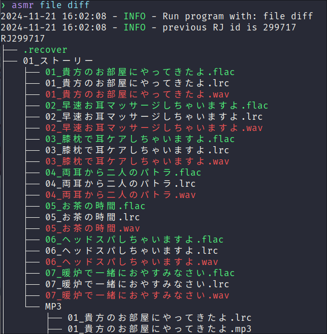
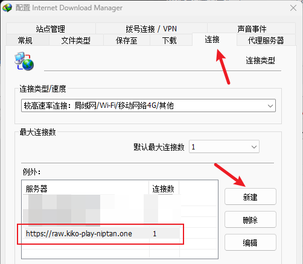

# ASMRManager

<details>
  <summary>

## →目录←

  </summary>

<!--toc:start-->

- [ASMRManager](#asmrmanager)
  - [功能介绍](#功能介绍)
    - [下载](#下载)
    - [管理](#管理)
    - [播放](#播放)
  - [使用方法](#使用方法)
  - [命令行补全](#命令行补全)
  - [使用示例](#使用示例)
  - [常见问题与使用提示](#常见问题与使用提示)
    - [IDM 不会自动下载，只能一个一个文件下载](#idm-不会自动下载只能一个一个文件下载)
    - [Windows CMD 中的显示错误问题（选项重复，无高亮显示）](#windows-cmd-中的显示错误问题选项重复无高亮显示)
    - [关于`dl search/get`的使用（作品，标签，文件的过滤细节）](#关于dl-searchget的使用作品标签文件的过滤细节)
    - [多线程下载相关](#多线程下载相关)
  - [其他](#其他)
<!--toc:end-->

</details>
包含下载，管理，播放(命令行 TUI)的 https://asmr.one 的 CLI 管理工具。

## 功能介绍

### 下载

- 支持网站所支持的所有索引方式(关键词，标签，会社，价格，声优，日期，时长，年龄分级等等)以及排序方式。
- （仅）支持调用 IDM 或 aria2 下载。
- 支持高度自定义的过滤规则，可实现对作品的标签，文件名进行过滤，按需下载。
- 支持音频文件与字幕文件的格式转换。

### 管理

下载的音声作品元数据会存储在本地 SQLite 数据库中，基于此提供了以下功能（仅本地）：

- 对作品进行评分、评论，记录收听状态和最近评价日期；私人备注保留在本地。
- 使用预定义的SQL脚本进行查询(仓库提供了一些模板，例如 [search.sql](./asmrmanager/filemanager/resources/sqls.example/search.sql))
- 在本地创建播放列表、添加已有作品、查询或删除列表，不依赖网络或登录。

此外，还可以对网站上的作品标签进行投票。

### 播放

非常简陋的终端播放界面，支持歌词显示，按照歌词信息快进，切换歌曲<del>，可以预见的将来应该会完善一下(但感觉够用了应该不会再加啥功能了)</del>，且不会再添加更多功能。如需更高级的播放功能，请使用第三方播放器，配合`asmr view add` 命令使用。


## 使用方法

> [!NOTE]
> 推荐使用 `pipx` 替代 `pip` 进行安装，以避免环境污染。
> 安装方法：`pip install pipx`

> [!NOTE]
> 从 `2.X` 升级到 `3.0` 后请参考[迁移说明](./MIGRATION.md)。
> 3.0 版本使用AI重构了大量模块，无明确的稳定性和兼容保证，暂不推荐升级。
> 目前仍只推荐安装[2.X版本](https://github.com/slqy123/ASMRManager/tree/2.X)：`pip install "ASMRManager[依赖]<3"`。

本工具支持 `python >= 3.12`，安装方法如下：

```shell
pip install ASMRManager[依赖]
```

可选则的依赖项有 `idm`，`aria2`，`player`，`tui`，`subtitle`，`image`，`all`，多个依赖使用逗号分隔，其中`all`为安装所有依赖。
具体功能如下：

- 下载：`idm` 或 `aria2` 二选一，`idm` 为 windows 平台专用，`aria2` 为跨平台。
- 播放： `player` 使用内置的命令行播放器，使用 `sounddevice` 库作为后端。
- 其他：`tui` 为可视化命令行界面。`image`提供在支持图像显示协议终端渲染作品封面的功能。`subtitle` 使用faster-whisper生成字幕文件。

其中，idm 与 aria2 至少安装其一，以实现最基础的下载功能，其余选项可随意按需添加。

示例： `pip install ASMRManager[idm,tui]`

---

之后再运行 `asmr` 命令，会生成示例的[配置文件](./asmrmanager/filemanager/resources/config.example.toml)和 sql 文件，此处以 windows 举例：

```
2023-10-22 14:36:21 - INFO - First time to run, copy default sqls to C:\Users\slqy\AppData\Local\asmrmanager\asmrmanager\sqls
2023-10-22 14:36:21 - INFO - An example config file has been copied to C:\Users\slqy\AppData\Local\asmrmanager\asmrmanager\config.toml, please modify it and run this command again
```

之后按照说明修改 `config.toml` 文件即可。

如果使用 sql 的话，也可以对 sql 文件夹进行修改。若有不明白的地方可使用 sqlite 数据库工具查看目录下的 data.db 文件。

完成后使用 `asmr -h` 查看各命令的使用说明，对于子命令不清楚的同样可以查看帮助，例如 `asmr dl -h`。
常用的命令有：

- `dl search` 搜索并下载。
- `info` 搜索某个 RJID 的具体信息
- `file check` 检查下载目录下的文件是否按照规则被正确下载，并验证文件完整性
- `file store` 将下载文件转移到存储目录(STORAGE_PATH)，并执行相应文件格式转换(详情见config.toml的before_store字段)
- `view` 选择文件并复制到 VIEW_PATH
- `pl add` 将本地数据库中已有的作品添加到本地播放列表(配合 `pl create` 使用)
- `vote up/down/add` 对相关标签进行投票，或添加新标签
- `review` 为某个作品评分并评论(本地)

更多使用示例可参考[这一小节](#使用示例)。

> 使用命令时，如果不输入 RJID ，将会自动使用上一次命令的RJID。

另外本工具提供基于 `trogon` 的可视化命令行界面，在安装`tui`依赖后使用 `asmr tui` 即可打开。

## 命令行补全

仅支持 Bash/Fish/Zsh，详情可参考[官方文档](https://click.palletsprojects.com/en/8.1.x/shell-completion)。

```shell
# fish
_ASMR_COMPLETE=fish_source asmr > ~/.config/fish/completions/asmr.fish

# bash
_ASMR_COMPLETE=bash_source asmr > ~/.asmr-complete.bash
echo '. ~/.asmr-complete.bash' >> ~/.bashrc

# zsh
_ASMR_COMPLETE=zsh_source asmr > ~/.asmr-complete.zsh
echo '. ~/.asmr-complete.zsh' >> ~/.zshrc
```

## 使用示例

搜索最近更新的40个(一页)作品并下载：

```shell
asmr dl search -o release --desc  # 选择并下载
asmr dl search -o release --desc --all  # 下载全部
```

下载`治愈`标签下销量大于等于5000的全部的作品：

```shell
asmr dl search --tags 治愈 --sell 5000: --page 0 --all  # --page 0 会遍历下载所有页，否则默认只会下载第一页
```

下载某个社团下的全年龄并包含中文字幕的作品：

```shell
asmr dl search --circle Yostar --age general --subtitle
```

预览搜索结果（不下载）
```shell
asmr dl search --preview --all  # 返回表格
# 也可以返回可解析的json数据，自定义下载规则，例如：
asmr dl search --json --all | jq '.[].id' | awk '$1 % 2 == 0' | xargs asmr dl get
# 将下载所有RJ号为偶数的作品
```

根据RJ/VJ/BJ号下载（下述输入格式适用于一切需要输入单个或多个ID的场合）：

```shell
asmr dl get RJ299717
asmr dl get 299717  # RJ可以省略；对于8位RJ号，第一位的0也可以省略
asmr dl get VJ015443
asmr dl get 100000029  # 对于BJ与VJ，网站为了兼容RJ所使用的特殊ID
asmr dl get 300015443  # 本项目存储VJ与BJ所使用的ID（"3" + 8位VJ号，BJ则为"4" + 8位BJ号）
```

终端图片显示(需安装image依赖且终端支持)：
```shell
asmr dl search --circle 'CANDY VOICE' --preview --page-size 2 --all
asmr info 1524462
```


检查下载目录下文件是否下载完全（默认会计算hash并向服务器验证，较为耗时。可使用 --offline 跳过）

```shell
asmr file check --all
asmr file check --all --list | xargs asmr dl get --force --replace   # 重新下载所有不完整的文件，以bash shell为例
```

将下载的文件转移到存储目录(STORAGE_PATH)，并执行相应文件格式转换(详情见config.toml的before_store字段)

```shell
asmr file store --all --check offline
# --check none，默认值，表示不检查文件完整性直接存储
# --check offline 只检查本地文件是否存在
# --check online 同时会向服务器验证hash
```

比较本地文件与服务器文件的差异：



打开音声所在文件夹(linux 上调用xdg-open，windows使用explorer.exe)：

```shell
asmr which --show <ID>
```

简单的关键词搜索（本地数据库）：

```shell
asmr query 治愈 --limit 3  # 搜索字段有：标题，社团名和标签名
asmr query 治愈 --limit 3 --raw | jq .[].id | xargs -n1 asmr info # 输出为json格式，获取详细信息
```

标签投票（对于\*nix用户，安装命令行补全后可以更快捷地找到想要的tag；windows用户也可以选择不传入tag，交互式选择tag）

```shell
asmr vote up -t ASMR
asmr vote down -t 497
asmr vote up  # 不传入-t参数，会进入交互式选择模式
```

本地播放列表管理：

```shell
asmr pl list
asmr pl list --num 100 --raw
asmr pl create myplaylist --desc "An example playlist" --privacy PRIVATE
asmr pl add myplaylist RJ123456 VJ015443
asmr pl show myplaylist
asmr pl rm myplaylist
```

列表可以使用本地 ID、唯一名称或配置文件中 `[playlist_aliases]` 的别名操作，名称重复时使用 `pl list` 显示的 ID。添加的作品需要已存在于本地数据库；删除列表不会删除作品和文件。

本地评价与收听状态：

```shell
asmr review RJ123456 --star 5 --comment "当前评论"
asmr review RJ123456 --progress listening
asmr review RJ123456 --clear-progress
asmr review RJ123456 --star 0 --comment ""
```

收听状态有 `marked`（想听）、`listening`（在听）、`listened`（听过）、`replay`（重听）、`postponed`（搁置）。评分和评论会记录评价日期，并尝试将已有文件移入存储目录；仅修改收听状态不会移动文件。`hold --comment` 的原因作为本地备注保存。

同步评分、评论、收听状态和播放列表（需配置登录信息）：

默认只在本地保存，在配置文件中按需开启对应的同步功能：

```toml
[sync]
star = false
comment = false
progress = false
playlist = false
```

开启后，`review` 会先保存本地，再上传本次修改的对应字段；本地备注和评价日期不会上传。上传失败可使用 `sync push` 重试，拉取云端数据使用 `sync pull`：

```shell
asmr sync push RJ123456
asmr sync push RJ123456 --field comment
asmr sync pull  # 展示差异，选择采用云端或保留本地
```

播放列表需要手动推送或拉取，`create/add/rm` 仍然只修改本地：

```shell
asmr pl push myplaylist  # 首次创建云端列表，之后以本地内容更新
asmr pl pull myplaylist  # 以云端内容更新本地列表
asmr pl pull --remote <cloud-playlist-id>  # 导入指定的云端列表
asmr pl bind myplaylist <cloud-playlist-id>  # 关联已有云端列表
asmr pl rm myplaylist --remote  # 同时删除云端和本地列表
```

`push/pull` 会展示差异并要求确认，不会按名称自动合并列表。云端关联只适用于当前服务和账号，换账号或服务后不能直接沿用。如果写入失败并提示云端结果可能未知，请先到网站核对，再决定是否重试。

生成字幕文件，目前仅支持LRC格式：

```shell
asmr utils subtitle
```

## 常见问题与使用提示

### IDM 不会自动下载，只能一个一个文件下载

默认不自动开始下载是预期内行为，IDM目前开放的API好像不支持后台静默下载。想要自动下载的话就无法在后台下载，也无法控制同时下载的文件数。

本应用会将下载任务发送到IDM的`主要下载队列`中，你需要打开IDM，点击开始队列才能下载。
如果想控制同时下载的文件数，可以找到`主要下载队列`，右键`编辑队列`即可修改。

### Windows CMD 中的显示错误问题（选项重复，无高亮显示）

Windows CMD缺少非常多的终端高级特性的支持，如需获得正确的显示效果，推荐使用 Windows Terminal + PowerShell。
其中 Windows Terminal 为 win11 的默认终端，win10 也可以直接从微软商店安装。

### 关于`dl search/get`的使用（作品，标签，文件的过滤细节）

命令执行过程中会进行如下的检查与过滤操作：

1. 开始下载前：检查RJ号是否应该下载，如果本地文件不存在或者数据库无记录都会执行下载操作。可以通过 `--force` 强制执行下载。
1. 获取音声信息后：检查音声的tags，如果包含tag_filters里指定的tag，则跳过下载。可以通过 `--ignore-tag` 来强制下载。
1. 获取下载文件后：检查文件的名称和路径，如果不符合filename_filters里指定的规则，则跳过下载。可以通过`--ignore-name`来强制下载。
1. 添加下载任务时：如果检测到下载目录有同名文件，则跳过该文件的下载。可以通过`--replace`来强制覆盖存在的文件。

### 多线程下载相关

由于网站对下载并无相关限制，因此没必要设置过高的线程数，一般来说单文件1～2即可。
对于 `IDM` 设置方法如下：


对于 `aria2` 修改配置 `max-connection-per-server = 2` 即可：

## 其他

感谢 <https://asmr.one>丰富了我的夜生活。
另外网站运营不易，请合理使用本工具。
